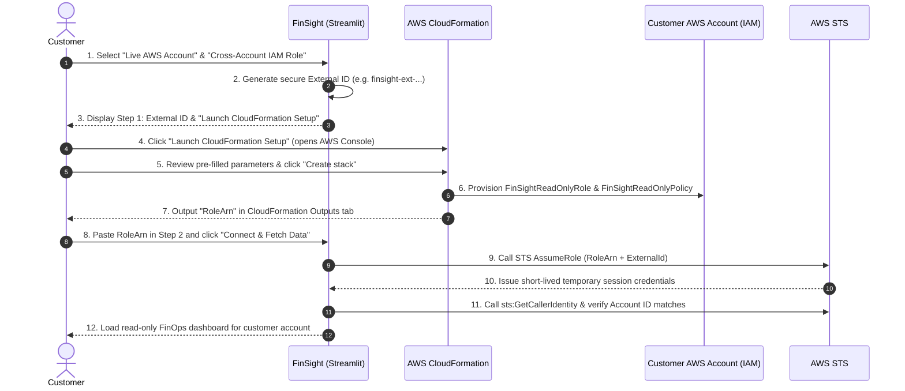

# Connect Your AWS Account to FinSight

This guide explains how to connect your AWS account to FinSight using **1-Click AWS CloudFormation Onboarding** (recommended) or manual IAM role configuration (fallback).

---

## Security Architecture & Guarantees

FinSight is built with an enterprise least-privilege, read-only security model:

- **Zero Permanent Credentials:** You never provide AWS Access Key IDs or Secret Access Keys. FinSight accesses your account using temporary, in-memory STS session credentials via `sts:AssumeRole`.
- **Confused Deputy Protection:** Every cross-account role assumption requires a cryptographically secure, unique `ExternalId` generated specifically for your connection session.
- **Strictly Read-Only:** The IAM permissions granted to FinSight are strictly limited to `Describe*`, `Get*`, and `List*` APIs for EC2, EBS, CloudWatch, and Cost Explorer.
- **Zero Resource Mutation:** FinSight contains zero logic or permissions to stop, terminate, reboot, delete, release, or modify your instances, volumes, Elastic IPs, tags, or VPCs.
- **Dry-Run Remediation:** All optimization actions (e.g., rightsizing or idle instance teardown) are computed purely as **dry-run simulations** and projected cost savings. FinSight will never mutate your cloud resources.
- **Strict Tenant Isolation:** Each connection session dynamically resolves and isolates data by AWS Account ID and Region. No customer data or credentials are persisted to disk or shared across sessions.

---

## Primary Method: 1-Click CloudFormation Quick-Create (Recommended)

The easiest and safest way to connect is using the pre-built AWS CloudFormation template.



### Step-by-Step Instructions

1. **Open FinSight Application**:
   Navigate to the FinSight web interface in your browser.

2. **Select Data Source**:
   In the left sidebar under **Data Source**, select **Live AWS Account**.

3. **Select Connection Method**:
   Under **Connection Method**, select **Cross-Account IAM Role**.

4. **Review Connection Details (Step 1)**:
   FinSight automatically generates a cryptographically secure External ID (e.g., `finsight-ext-xxxxxxxxxxxxxxxxxxxxxxxxxxxxxxxx`).
   *(If you wish to reset or start fresh, click **Start New AWS Connection**).*

5. **Launch CloudFormation**:
   Click the **🚀 Launch CloudFormation Setup** button. This opens the AWS CloudFormation Quick-Create console in your selected region in a new tab.

6. **Review CloudFormation Parameters**:
   The AWS console will open with all parameters pre-populated:
   - **Stack name:** `FinSight-Connection`
   - **FinSightProductionTaskRoleArn:** The ARN of the FinSight application task execution role.
   - **ExternalId:** The exact External ID generated in Step 4.

7. **Acknowledge & Create Stack**:
   Check the box: *"I acknowledge that AWS CloudFormation might create IAM resources with custom names."*
   Click **Create stack**.

8. **Wait for Stack Creation**:
   Wait approximately 15–30 seconds until the stack status shows **CREATE_COMPLETE**.

9. **Copy Role ARN from Outputs**:
   Click on the **Outputs** tab of the `FinSight-Connection` stack and copy the value for **RoleArn**:
   ```text
   arn:aws:iam::<YOUR_ACCOUNT_ID>:role/FinSightReadOnlyRole
   ```

10. **Connect in FinSight (Step 2)**:
    Return to the FinSight browser tab. Under **Step 2 — Connect Role**, paste the copied **Role ARN**.

11. **Fetch & Analyze**:
    Click **Connect & Fetch Data**.
    FinSight assumes the role using the matching External ID, validates caller identity against your Account ID, and renders your read-only FinOps intelligence dashboard.

---

## Fallback Method: Manual IAM Role & Policy Setup

If your organization requires manual IAM change management or uses custom Infrastructure as Code (IaC) pipelines (e.g. Terraform / CDK), you can configure the role manually.

### 1. Create the Read-Only IAM Policy

Create an IAM Policy named `FinSightReadOnlyPolicy` with the following least-privilege permissions:

```json
{
  "Version": "2012-10-17",
  "Statement": [
    {
      "Sid": "FinSightCostExplorerRead",
      "Effect": "Allow",
      "Action": [
        "ce:GetCostAndUsage",
        "ce:GetCostAndUsageWithResources"
      ],
      "Resource": "*"
    },
    {
      "Sid": "FinSightEC2Read",
      "Effect": "Allow",
      "Action": [
        "ec2:DescribeInstances",
        "ec2:DescribeVolumes",
        "ec2:DescribeAddresses",
        "ec2:DescribeTags",
        "ec2:DescribeVpcs",
        "ec2:DescribeSubnets",
        "ec2:DescribeSecurityGroups"
      ],
      "Resource": "*"
    },
    {
      "Sid": "FinSightCloudWatchRead",
      "Effect": "Allow",
      "Action": [
        "cloudwatch:GetMetricData",
        "cloudwatch:GetMetricStatistics",
        "cloudwatch:ListMetrics"
      ],
      "Resource": "*"
    },
    {
      "Sid": "FinSightIdentityRead",
      "Effect": "Allow",
      "Action": [
        "sts:GetCallerIdentity"
      ],
      "Resource": "*"
    }
  ]
}
```

### 2. Create the Cross-Account IAM Role

1. In the AWS IAM Console, click **Roles** > **Create role**.
2. Select **Custom trust policy**.
3. Paste the trust policy below, substituting the placeholders:

```json
{
  "Version": "2012-10-17",
  "Statement": [
    {
      "Effect": "Allow",
      "Principal": {
        "AWS": "<FINSIGHT_PRODUCTION_TASK_ROLE_ARN>"
      },
      "Action": "sts:AssumeRole",
      "Condition": {
        "StringEquals": {
          "sts:ExternalId": "<FINSIGHT_EXTERNAL_ID>"
        }
      }
    }
  ]
}
```

4. Attach `FinSightReadOnlyPolicy` to the role.
5. Name the role `FinSightReadOnlyRole` and create it.

### 3. Connect via FinSight Manual Mode

1. In FinSight, check the box: **"Already have a configured FinSight role?"**.
2. Enter your **Role ARN** (`arn:aws:iam::<YOUR_ACCOUNT_ID>:role/FinSightReadOnlyRole`).
3. Enter your configured **External ID**.
4. Click **Connect & Fetch Data**.

---

## Verifying Connection & Troubleshooting

Upon connection, FinSight displays a verified connection banner at the top of the dashboard:

```text
● Connected to AWS
AWS Account: 123456789012  |  Region: us-east-1
Identity: arn:aws:sts::123456789012:assumed-role/FinSightReadOnlyRole/FinSightSession
```

### Common Issues:

| Error Symptom | Root Cause | Resolution |
|---|---|---|
| `Unable to assume the specified FinSight role (AccessDenied)` | The trust policy principal or External ID does not match the session. | Verify that `ExternalId` in the role trust policy exactly matches the one displayed in FinSight, and `Principal.AWS` matches FinSight's production role ARN. |
| `AWS Account ID mismatch` | The provided Role ARN specifies account `111111111111`, but the assumed session returned account `222222222222`. | Ensure the pasted Role ARN belongs to the expected target account. |
| `Invalid AWS Role ARN format` | The entered ARN is malformed. | Ensure the ARN matches `arn:aws:iam::<12-digit-account-id>:role/<RoleName>`. |
