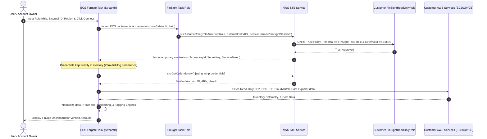

# FinSight Production Architecture & Amazon ECS Express Mode Design

This document details the production hosting architecture for **FinSight — Cloud Cost Optimization & Governance (FinOps)** using **Amazon ECS Express Mode + AWS Fargate**, enabling multi-tenant, cross-account AWS analysis for any external AWS account owner.

---

## 1. Hosting Platform: Amazon ECS Express Mode + AWS Fargate

AWS App Runner is closed to new customers. In accordance with AWS guidance, **Amazon ECS Express Mode** with **AWS Fargate** is selected as the modern, fully managed production hosting architecture.

### Key Architectural Benefits:
- **Serverless Execution:** Runs on AWS Fargate without managing underlying EC2 virtual machines.
- **Automated Networking & HTTPS:** ECS Express Mode automatically configures managed ingress routing and HTTPS endpoints directly to the containerized application.
- **Native Task Role Support:** Allows attaching an IAM Task Role (`FinSightProductionTaskRole`) to the container task, providing the source identity needed for cross-account AWS STS `AssumeRole` without static API keys.
- **Port & Protocol Support:** Fully supports Streamlit on TCP port `8501` including WebSockets for live interactive dashboards.
- **Cost & Resource Efficiency:** Configured with 1 vCPU and 2 GB memory, scaling on demand.

---

## 2. Architectural Components

```text
┌─────────────────────────────────────────────────────────────────────────────┐
│                       FinSight Hosting Account (AWS)                        │
│                                                                             │
│   ┌─────────────────────────────────────────────────────────────────────┐   │
│   │                     Amazon ECS Express Mode Service                 │   │
│   │                                                                     │   │
│   │   ┌────────────────────────┐        ┌───────────────────────────┐   │   │
│   │   │  Streamlit UI & Engine │        │ FinSight Task Role        │   │   │
│   │   │  (Fargate on port 8501)│◄───────┤ (FinSightProduction-      │   │   │
│   │   │                        │        │  TaskRole)                │   │   │
│   │   └───────────┬────────────┘        └─────────────┬─────────────┘   │   │
│   └───────────────┼───────────────────────────────────┼─────────────────┘   │
└───────────────────┼───────────────────────────────────┼─────────────────────┘
                    │                                   │
                    │ 1. Connect (Role ARN, Ext ID)     │ 2. sts:AssumeRole
                    ▼                                   ▼
       ┌────────────────────────┐         ┌───────────────────────────┐
       │   Tenant / Customer    │         │      AWS STS Service      │
       │   (Browser Session)    │         │  (Temporary Credentials)  │
       └────────────────────────┘         └─────────────┬─────────────┘
                                                        │
                                                        │ 3. Temporary Scoped Session
                                                        ▼
       ┌──────────────────────────────────────────────────────────────────────┐
       │                         Customer AWS Account                         │
       │                                                                      │
       │   ┌──────────────────────────────────────────────────────────────┐   │
       │   │                    FinSightReadOnlyRole                      │   │
       │   │           (Trusts FinSight ECS Fargate Task Role)            │   │
       │   └──────────────────────────────┬───────────────────────────────┘   │
       │                                  │                                   │
       │                                  │ 4. Read-Only Telemetry Queries    │
       │                                  ▼                                   │
       │      ┌───────────────────┬───────────────────┬───────────────────┐   │
       │      │   EC2 / EBS / EIP │   CloudWatch CPU  │   Cost Explorer   │   │
       │      │   (Read-only)     │   (14-day metric) │   (Spend records) │   │
       │      └───────────────────┴───────────────────┴───────────────────┘   │
       └──────────────────────────────────────────────────────────────────────┘
```

1. **User / Browser Session:** Connects over HTTPS to FinSight's ECS Express endpoint. Provides target `Role ARN`, `External ID`, and `Region`.
2. **FinSight Container (AWS Fargate):** Runs the containerized Python/Streamlit application on port 8501.
3. **ECS Task Execution Role (`ecsTaskExecutionRole`):** Used strictly by ECS infrastructure to pull the ECR image and stream logs to CloudWatch.
4. **FinSight Application Task Role (`FinSightProductionTaskRole`):** Dedicated task identity available to container code for executing `sts:AssumeRole`.
5. **AWS Security Token Service (STS):** Validates the trust relationship and External ID, returning short-lived (1-hour), temporary credentials kept in process memory.
6. **Customer Role (`FinSightReadOnlyRole`):** Lives in customer's AWS account. Grants least-privilege read-only permissions (`ec2:Describe*`, `cloudwatch:Get*`, `ce:Get*`, `sts:GetCallerIdentity`).
7. **Customer AWS Resources:** Target EC2, EBS, Elastic IPs, CloudWatch metrics, and Cost Explorer spend inspected by FinSight.

---

## 3. End-to-End Request Flow



---

## 4. ECS IAM Roles Separation

See [**`docs/ecs-iam-architecture.md`**](file:///Users/aryanrangani/Downloads/College/SEM%207/CP/finsight_finops/docs/ecs-iam-architecture.md) for full policy specifications.

1. **ECS Task Execution Role (`ecsTaskExecutionRole`):**
   - Managed policy `AmazonECSTaskExecutionRolePolicy` attached.
   - Used by Fargate agent to pull images from ECR and write logs to CloudWatch.
2. **FinSight Application Task Role (`FinSightProductionTaskRole`):**
   - Attached to the container task definition.
   - Grants `sts:AssumeRole` on `arn:aws:iam::*:role/FinSightReadOnlyRole`.
   - Has **ZERO** read/write/delete permissions in the hosting AWS account.
3. **ECS Express Mode Infrastructure Role (`ecsInfrastructureRoleForExpressServices`):**
   - Used internally by ECS Express Mode for infrastructure management and gateway routing.

---

## 5. Customer Trust Policy Design

The customer creates `FinSightReadOnlyRole` in their own AWS account with the following trust relationship:

```json
{
  "Version": "2012-10-17",
  "Statement": [
    {
      "Effect": "Allow",
      "Principal": {
        "AWS": "<FINSIGHT_PRODUCTION_TASK_ROLE_ARN>"
      },
      "Action": "sts:AssumeRole",
      "Condition": {
        "StringEquals": {
          "sts:ExternalId": "<FINSIGHT_EXTERNAL_ID>"
        }
      }
    }
  ]
}
```

- `<FINSIGHT_PRODUCTION_TASK_ROLE_ARN>`: The ARN of FinSight's ECS Task Role (e.g. `arn:aws:iam::<FINSIGHT_HOST_ACCOUNT_ID>:role/FinSightProductionTaskRole`).
- `<FINSIGHT_EXTERNAL_ID>`: Tenant-specific random external ID token provided to the customer.

---

## 6. External ID Production Strategy

1. **Confused Deputy Protection:** Prevents unauthorized cross-tenant role assumptions.
2. **In-Memory Transmission:** UI password-masks the External ID and transmits it directly to `boto3` STS without writing to log files or persistent disks.
3. **Stateless Operation:** External IDs are supplied by the user during connection. In an enterprise SaaS evolution, a persistent database service can be introduced to auto-generate and manage customer External IDs.

---

## 7. Multi-User Isolation & Session Scoping

- **`st.session_state` Isolation:** Session state is partitioned per browser session/tab.
- **`@st.cache_data` Partitioning:** The analysis function `cached_live_analysis(...)` hashes the specific `role_arn`, `region`, and `observation_days`. User A's data is never cached or served to User B.
- **Zero Global Mutable State:** Analysis outputs and AWS credentials are never stored in global variables.

---

## 8. Health Check Mechanism

- **Endpoint:** `/_stcore/health` (built into Streamlit)
- **Response:** HTTP 200 `ok`
- **Fargate Container Health Check:** Configured in `Dockerfile` to probe `http://localhost:8501/_stcore/health`.
